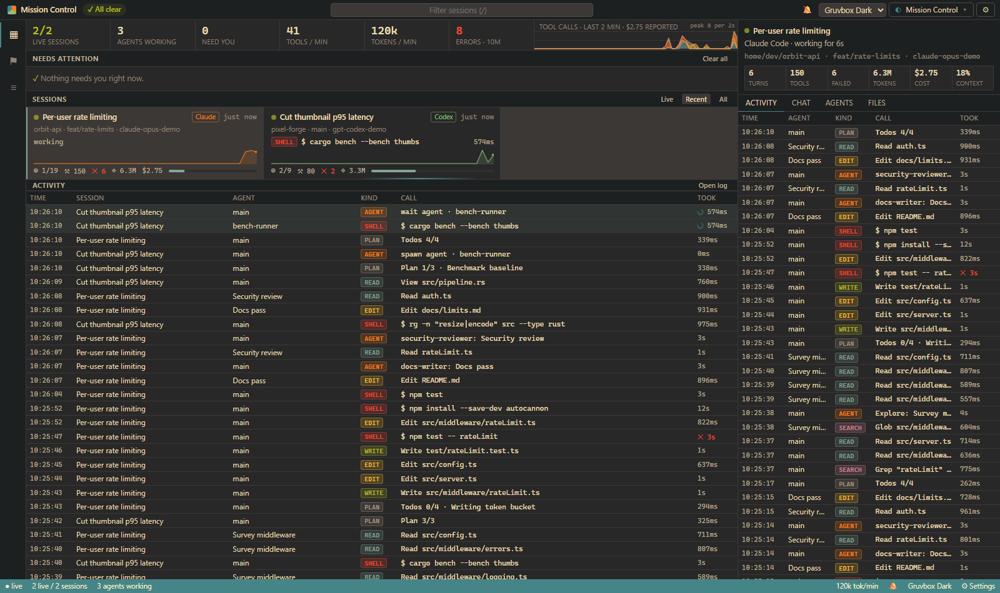
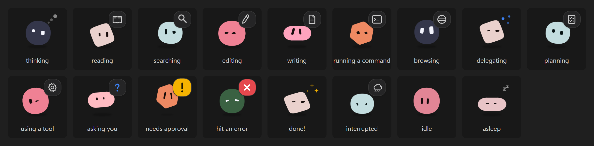
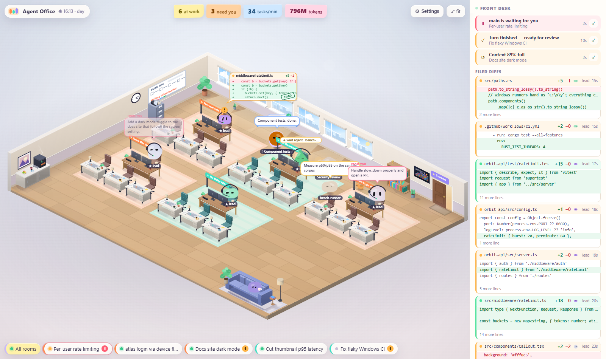
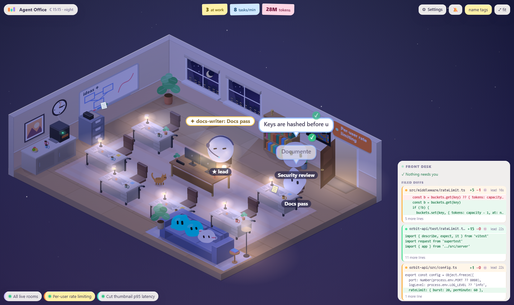
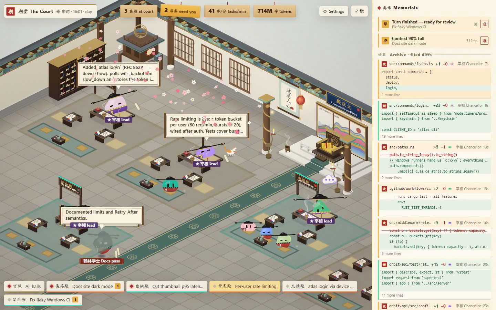
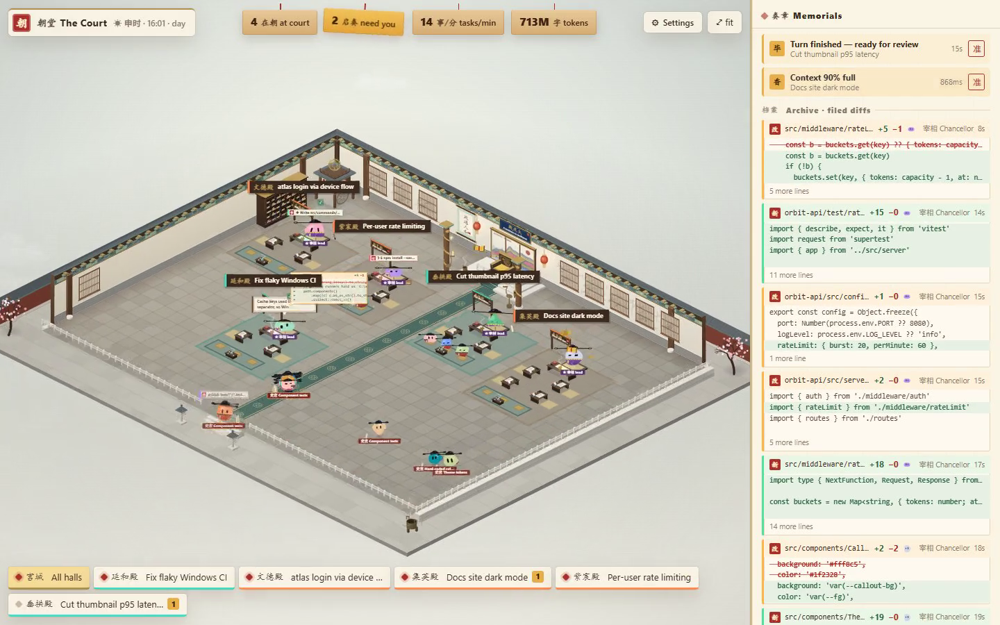
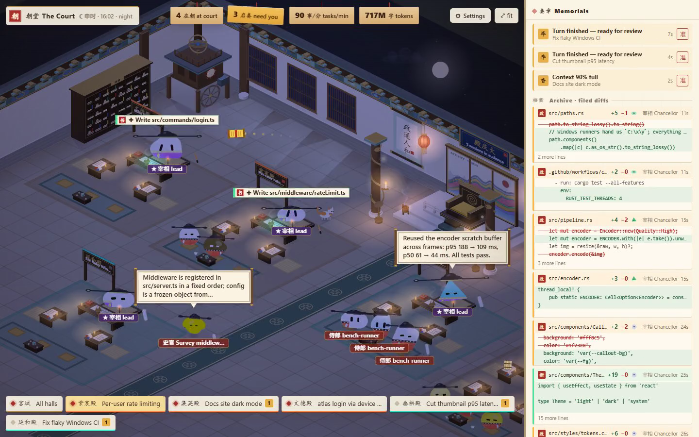

# Visualizations

The web app is a thin **host**. It connects to the observer once and mounts
one **visualization** at a time. A visualization is not a theme or a skin. It
owns everything inside its element:

- its DOM and layout (sidebars, HUDs, panels, or none at all)
- its rendering technology (canvas 2D, SVG, WebGL, a framework, plain HTML)
- its own input handling, camera, animation loop and styles
- its own *interpretation* of the data (a dashboard, an office building, a table…)

What it does **not** do is parse transcripts, derive agent status or link
subagents. That all happens in the core, and the visualization reads it from
the live `WorldState` and the event stream.

Choose which visualization to show in **Settings › Visualizations** (the `⚙` button in every
visualization, or `Ctrl+,`). Each visualization has its own page there for its options, such as
Mission Control's theme. `?viz=<id>` in the URL and the `V` key also switch.

## Built in

| | |
|---|---|
| **Mission Control** (`mission`, the default) | A compact IDE-style dashboard: what needs you, what is running, and how fast, with a blob buddy per agent. Themeable. See below. |
| **Agent Office** (`office`) | A cute isometric office. Every session is a team pod on one open-plan floor (or its own room), and each agent a little blob. See below. |
| **The Court** (`court`) | An isometric Tang–Song audience hall (朝堂). Every session is a delegation in one great hall (or its own hall), the lead is the Chancellor and subagents are ministers who raise their tablet when they need you. See below. |

### Mission Control



Built for daily use on a second monitor:

- **Needs attention.** Approvals waiting (with a live timer), finished turns ready for review, failure streaks, context almost full, and tools that have run unusually long. Acknowledge items one by one, or clear them all with `X`.
- **Notifications.** Off by default. Turn on desktop notifications, a chime and the tab-title count on the settings page, and choose which kinds alert you. They work in every visualization, not just this one.
- **Buddies.** Each session tile has a blob buddy (drawn by [blobatar](https://github.com/Alain00/blobatar)) whose face, motion and prop follow what the agent is doing: a pencil and typing bounce while editing, a magnifier while searching, a terminal while running a command, a hop and a "!" when it needs approval, a red ✕ and a shake when a tool fails, sparkles when a turn finishes and Zzz when idle for long. Busy subagents appear as tiny buddies beside it, the drawer shows a large one, and each agent in the Agents tab has its own. Poses are held briefly so a burst of quick tools does not flicker.

  

- **Live overview.** KPIs (live sessions, working agents, tools/min, tokens/min, recent errors), a smoothly scrolling throughput chart by tool kind, and compact session tiles. Each tile shows what the session is doing right now with a ticking timer, a heartbeat line that spikes on every tool call, and a context gauge.
- **Live diffs.** Edits stream in as coloured diffs the moment an agent makes them (Claude Code's Edit, MultiEdit and Write, Codex's apply_patch) and replay as if typed: removed lines are struck in, then the new code types itself out behind a caret. A running feed of every tool call sits beside them. Expand a diff for the full change.
- **Session drawer.** Open a session (click a tile, or `Enter`) to slide in its Activity (every tool call with input and output), Diffs, Chat, Agents (the tree and what each is waiting on) and Files. Pin it in Settings to keep it docked instead.
- **Themes.** Dark Modern, Light Modern, Gruvbox Dark and Gruvbox Light, or follow the system, in Settings › Visualizations › Mission Control.

Keys: `/` filter, `J`/`K` move between sessions, `Enter` open, `Esc` close, `1`–`5` drawer tabs, `X` acknowledge all.

Everything animates in and out (new rows, diffs, tiles, counters) and respects `prefers-reduced-motion`.

### Agent Office



How the data maps onto the office:

| What happens | What you see |
|---|---|
| A session | A team pod on the open-plan floor (or its own room) with the team's colour on the rug and the session title on its sign. Its lead is the same blob the session has in Mission Control |
| The main agent | The team lead, a blob in a headset, at the big two-monitor desk |
| A subagent is spawned | The phone rings at the parent's desk, the door swings open and a new blob hops in to a free desk |
| A subagent finishes | It takes a coffee break on the couch, then heads home through the door |
| A tool call | The blob bobs along (typing, peering, humming, depending on the tool), its screen glows in the tool's colour and a chip shows what it's doing |
| Reading files | Papers fly from the filing cabinet to the desk |
| Editing files | The blob types the diff out in a bubble beside it (the changed lines, with a caret), stamps it FILED and sends it flying to the front desk, where the full diff card lands |
| A tool fails | A puff of smoke, a red ✗ and a queasy face for a few seconds |
| Thinking | A thought cloud with bubbling dots and a pensive face |
| Waiting on you (permission prompt) | The blob hops in place with a scared face, a "!" bubble bounces and an amber ring pulses on the floor |
| Your prompt | A paper airplane flies in through the window to the lead, and the note pops up "FROM YOU" |
| An assistant message | A speech bubble |
| A question for you | A "?" bubble and a shy face |
| A plan / todo update | The whiteboard shows checkboxes and the current step |
| A finished turn | Confetti and a little jump |
| Long idle | Zzz |

There are also real details: the wall clock shows your time, the wall screen by
the door charts the session's tool calls over the last 15 minutes, the windows
follow day and night (click the clock to force day or night, or use
`?time=day`), desk lamps and the floor lamp switch on after dark, the coffee
machine steams, and there's an office cat.

Everything is drawn procedurally on a canvas, no image assets: one light
source shades every face, furniture casts soft shadows, and night is a
multiply wash with the lamps and screens added back on top. The blobs are
[blobatar](https://github.com/Alain00/blobatar) faces drawn as canvas paths,
seeded exactly as in Mission Control, so an agent looks the same wherever you
meet it; the expression and body motion follow the shared activity model.

Click any blob for its profile card: mood, role, model, current task, recent
tools and the files it just changed, and for the lead the session's turns,
cost and context fill. Drag to pan and scroll to zoom. `F` fits the view, `L`
toggles name tags, `D` toggles the front desk sidebar, `A` shows all rooms,
`J`/`K` step through rooms and `X` acknowledges everything.

The **front desk** sidebar (toggle with `D` or in Settings; it never
covers the office) shares Mission Control's attention queue: approvals,
finished turns, failure streaks, nearly full context and long-running tools,
each with a ✓ to acknowledge. Click an item to jump to that room and agent.
Under it, **Filed diffs** holds the latest changes from the rooms on screen,
same cards as Mission Control's live diff feed (click one to expand); a
change only appears there once its bubble has been filed. The "need you"
sticky counts open items.

**One open-plan floor** is the default when more than one session is on
stage: every session is a team pod on the same floor, with its own rug, a
hanging sign with the session title, the lead's big desk at the head and rows
of three desks behind it. A pod grows a row of desks at a time as its team
grows, and the floor grows to fit the pods (two side by side, then a 2×2,
then three or four across). The door, coffee counter, filing cabinet,
whiteboard, wall screen and lounge are shared, so a lead working alone still
shares a busy room with every other session. Clicking a tab glides the
camera to that team's pod instead of switching rooms; from far away each pod
gets a readable banner with a "needs you" count. Choose **A room per
session** in Settings to go back to separate rooms.

The office has the same themes as Mission Control (Dark, Light, Gruvbox Dark,
Gruvbox Light or follow the system). A theme colours the controls, the front
desk and the space around the rooms; day and night lighting is separate and
still changes the rooms themselves. The room layout, theme, name tags, the
front desk and lighting are all in Settings › Visualizations › Agent Office.



### The Court



An imperial audience hall drawn from Tang and Song China. You are the
emperor: the throne stands empty, and the court comes to you.

| What happens | What you see |
|---|---|
| A session | A delegation's bay in the great hall, named after a hall of the Song palace (紫宸殿, 垂拱殿…) on its signboard with the session title; or, with a hall per session, its own hall with the name on the plaque above the throne |
| The main agent | The Chancellor (宰相) in a purple robe, kneeling at the big desk at the foot of the throne |
| A subagent | A minister in a 展脚幞头 hat, kneeling at a desk in the west or east rank. Robe colours follow the Tang ranks by depth: purple, crimson, green, blue. Titles follow the subagent type (Explore → 史官 Historian, Plan → 枢密使 Privy Councillor, review → 御史 Censor…) |
| A subagent is spawned | A gong ripples at the front steps, the Chancellor raises a tiger tally (虎符) and the new minister climbs the steps to a free desk |
| A subagent finishes | It takes tea in the pavilion, then leaves down the steps |
| Waiting on you (permission prompt) | The minister walks up before the throne, kneels and **raises the ivory tablet (笏)**. A gold "奏" seal bounces above it, a golden pool pulses on the floor and the empty throne glows |
| Your prompt | An imperial edict scroll glides down from the throne to the Chancellor, then opens as "圣谕 · FROM YOU" |
| Editing files | A memorial (奏折) is written out beside the minister: new lines in black ink, removed lines struck through in vermilion (朱批). It is stamped 准 and flies to the archive in the sidebar |
| Reading or searching | Bamboo slips fly between the archive's pigeonholes and the desk; the minister holds a scroll or a bundle of slips |
| Running a command | Su Song's astronomical clock tower turns its water wheel and armillary sphere; its drum strikes when the command ends. The minister works an abacus |
| Web research | A messenger pigeon flies out of the lattice window and comes back when the result arrives |
| Thinking | Incense smoke curls up into a cloud; the Chancellor's censer smokes harder |
| A plan / todo update | The hanging scroll beside the throne lists the steps, sealed in red as they are done |
| A tool fails | Ink spills across the desk and blots the robe |
| A finished turn | Plum blossom drifts down over the hall and the Chancellor bows |
| A turn is interrupted | A candle-snuff wisp of smoke |
| Context window | An incense stick on each desk burns down as the context fills |
| Tool calls over the last 15 minutes | The landscape on the folding screen behind the throne: each tool kind is a ridge of blue-green mountains |

With several sessions on stage they share **one great hall** (大庆殿) by
default: every session is a delegation in its own bay, with a signboard
bearing its hall name and title, its Chancellor kneeling in the front line
before the throne and its ministers in ranks behind. The hall grows wide, as
real halls are measured in bays across: one bay on each side of the carpet
for two delegations, two on each side for up to four, and only then a second
line. A bay deepens a row of desks at a time as its delegation grows. The
places before the throne are shared, so ministers from every bay walk up the
carpet to present their matters. Tabs glide the camera to a bay;
double-click a bay to do the same. From far away each bay gets a banner with
a "needs you" count. Choose **A hall per session** in Settings for separate
halls, each in its own walled courtyard. At night the lanterns, candles and
stone lanterns light the hall and moonlight falls through the windows.



The sidebar holds the **memorials** (奏章, the shared attention queue; the 准
seal acknowledges one), the **archive** (档案, filed diffs) and the **court
diary** (起居注). Click a minister for its appointment certificate (告身):
title, rank, model, task, recent tools and changes, and the incense gauge.
Keys are the same as the office: `F`, `L`, `D`, `A`, `J`/`K`, `X`, `Esc`.

Settings › Visualizations › The Court has the halls (one great hall, or a
hall per session), the palette (Tang vermilion and gold, Song celadon and
timber, or ink wash), the throne (empty, or seat an
emperor), how much Chinese the labels use, the panel theme, name tags, the
sidebar and lighting.



## Writing your own

Implement the `Visualization` interface from
[`apps/web/src/viz/types.ts`](../apps/web/src/viz/types.ts) and add it to
[`apps/web/src/viz/index.ts`](../apps/web/src/viz/index.ts):

```ts
import type { Visualization } from '../types'
import { Disposer } from '../types'
import { sessionList } from '@oadt/protocol'

export const ticker: Visualization = {
  id: 'ticker',
  name: 'Ticker',
  description: 'One line per session, like a stock ticker.',
  icon: '≡',
  settings: [{ key: 'compact', label: 'Compact rows', type: 'toggle', default: false }],
  mount(root, { client, controls, settings }) {
    const d = new Disposer()
    root.innerHTML = '<div class="ticker"><header></header><ul></ul></div>'
    root.querySelector('header')!.append(controls) // the settings button; leave it out and the host floats it
    root.classList.toggle('compact', settings.get<boolean>('ticker.compact'))
    const list = root.querySelector('ul')!
    d.add(client.onChange((world) => {
      list.replaceChildren(...sessionList(world).map((s) => {
        const li = document.createElement('li')
        li.textContent = `${s.status.toUpperCase()} ${s.meta.title ?? s.id} — ${s.counts.tools} tools`
        return li
      }))
    }))
    return { destroy: () => d.dispose() }
  },
}
```

The rules:

1. **Everything you need is on `ctx`.** `ctx.client` is the live data,
   `ctx.settings` stores your options (declare them in `settings` on the
   visualization and they get their own page under Settings › Visualizations),
   `ctx.setChromeTheme()` makes the settings dialog match your look, and
   `ctx.attention` shares what needs the
   user, including acknowledgements. On the client, `client.world` is the live
   `WorldState`. `client.onChange((world, events) => …)` fires at most once
   per microtask with the new events. `client.sessionEvents(id)` gives history.
   The selectors in `@oadt/protocol` (`sessionList`, `agentTree`, `openTools`,
   `hotFiles`…) cover most derived views.
2. **Clean up in `destroy()`.** `Disposer` helps: `d.add(unsubscribe)`,
   `d.listen(window, 'keydown', fn)` and `d.loop(frame)` for a
   requestAnimationFrame loop that stops on dispose. The host removes your
   element afterwards.
3. **Don't assume you mounted first.** The client may already be live with a
   full world when you mount, so render from `client.world` straight away.
4. **Keep styles scoped.** Every visualization's CSS ends up in the same
   bundle. Prefix your classes (the office uses `of-`).
5. **If two visualizations need the same derived data, put it in the core.**
   That keeps them honest and lets frontends outside the web app, like the
   terminal dashboard and React hooks, have it too.

Outside the web app you can build a frontend with anything. See
[FRONTENDS.md](FRONTENDS.md) for raw SSE, the client SDK, the React hooks and
embedding the core directly.
